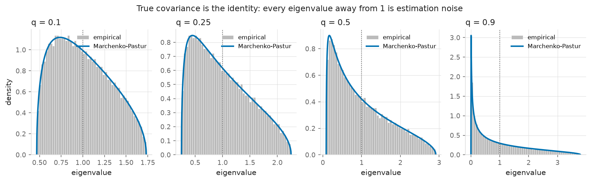
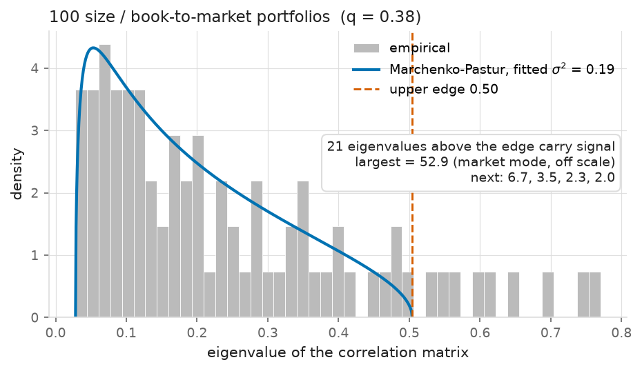
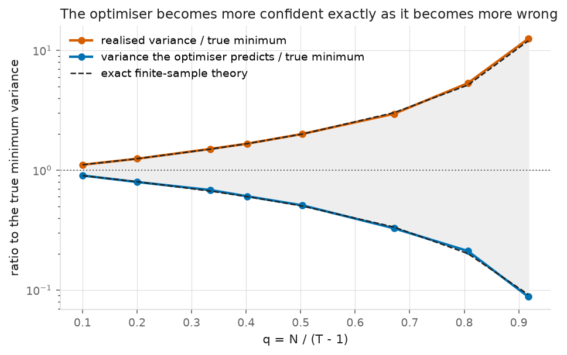
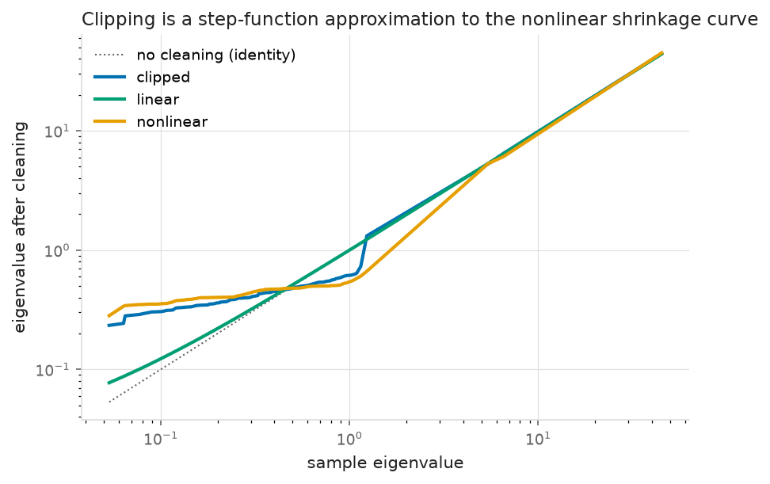
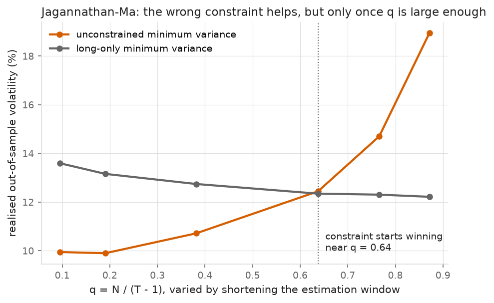
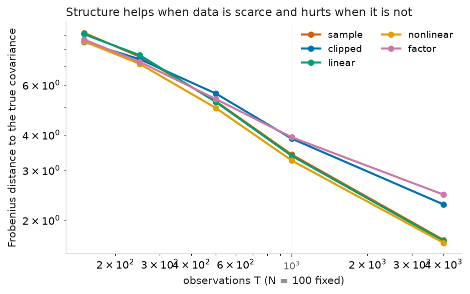

# Portfolio optimisation under estimation error

[](https://github.com/bkhmath/portfolio-estimation-error/actions/workflows/ci.yml)


A minimum-variance optimiser given 95 portfolios and one year of daily returns
realises **4.2 times the variance it predicted for itself**. Cleaning the
covariance matrix with random matrix theory cuts that ratio to 2.7 and lowers
realised out-of-sample volatility from 10.72% to 9.51%, an 11.3% reduction,
while roughly halving turnover.

None of this is a numerical problem. The sample covariance is an unbiased
estimator of Σ whose inverse is a badly biased estimator of Σ⁻¹, and the
minimum-variance portfolio `w ∝ Σ⁻¹1` is built entirely out of the inverse. The
size of that bias is not a mystery either: it is the Marchenko–Pastur law. This
repository derives the law, checks it against simulation (Kolmogorov–Smirnov
distance 0.0022 at N = 1600, falling like 1/N), and then measures what each
standard repair is worth.

### Why variance and not return

Stated before any result, because it limits what the project can claim. The two
quantities are not equally estimable. The sample mean of a return series has
standard error σ/√T; with σ around 20% a year against a mean of perhaps 6%,
pinning the mean to within a percentage point takes roughly 400 years of data.
Sampling the same twenty years more finely does not help, since the drift grows
with elapsed time while its noise grows with the square root. Quadratic
variation is different: it really is estimable at high frequency, and a few
hundred daily observations give a usable covariance matrix. So the
minimum-variance portfolio is where better estimation can win, and that is what
this project studies. The argument is set out in
[`optimise.py`](src/estimation_error/optimise.py) and measured further down.

---

## The result

100 size / book-to-market portfolios (N = 95 after dropping incomplete series,
250-day estimation window, so q = N/(T−1) = 0.38), daily, 1970–2026, monthly
rebalancing, 668 out-of-sample rebalances:

| | realised vol | vol it predicted | realised/predicted | gross Sharpe | turnover | break-even vs 1/N |
|---|---|---|---|---|---|---|
| sample covariance | 10.72% | 5.24% | 4.19 | 1.51 | 3.15 | 21 bp |
| eigenvalue clipping | 9.51% | 5.80% | 2.68 | 1.70 | 1.63 | 45 bp |
| linear shrinkage | 9.79% | 6.17% | 2.52 | 1.65 | 2.11 | 34 bp |
| nonlinear shrinkage | 9.55% | 6.17% | 2.40 | 1.66 | 1.35 | 52 bp |
| PCA factor model | 9.90% | 5.38% | 3.39 | 1.61 | 1.85 | 37 bp |
| long-only (sample) | 12.74% | 11.49% | 1.23 | 1.21 | 0.29 | 167 bp |
| equally weighted 1/N | 17.48% | 17.47% | 1.00 | 0.78 | 0.02 | — |

49 industry portfolios (q = 0.20), same protocol:

| | realised vol | realised/predicted | gross Sharpe | turnover | break-even vs 1/N |
|---|---|---|---|---|---|
| sample covariance | 10.68% | 2.03 | 0.87 | 1.18 | 8.8 bp |
| eigenvalue clipping | 10.64% | 1.95 | 0.89 | 0.93 | 13.4 bp |
| linear shrinkage | 10.39% | 1.65 | 0.92 | 0.87 | 17.0 bp |
| nonlinear shrinkage | 10.38% | 1.69 | 0.90 | 0.83 | 15.7 bp |
| PCA factor model | 11.27% | 2.50 | 0.83 | 1.30 | 5.7 bp |
| long-only (sample) | 11.51% | 1.18 | 0.93 | 0.21 | 87.7 bp |
| equally weighted 1/N | 16.68% | 1.00 | 0.75 | 0.03 | — |

The two tables are worth reading together. The benefit of cleaning scales with
q, as the theory says it should: at q = 0.20 the gap between the best and worst
covariance estimator is 8.5% of volatility, at q = 0.38 it is 12.7%, and the
sample covariance's self-deception doubles from 2.0× to 4.2×.

---

## The diagnosis

### Marchenko–Pastur

For T observations of N uncorrelated unit-variance series with q = N/T, the
eigenvalues of the sample covariance do not concentrate at 1. They spread over
[(1−√q)², (1+√q)²]. At q = 0.4 that is [0.13, 2.65], a twentyfold spread
produced by nothing but estimation noise.



The law is derived rather than fitted. The Stieltjes transform of the limiting
spectral distribution satisfies a quadratic, `q z m² + (z+q−1) m + 1 = 0`; the
density is the imaginary part of its solution on the real axis, and the bulk
edges are the branch points of the same square root. Derivation in
[`docs/marchenko-pastur.md`](docs/marchenko-pastur.md), implementation in
[`rmt.py`](src/estimation_error/rmt.py).

On real returns, an eigenvalue inside the bulk cannot be told apart from noise.
The ones outside carry information, and the largest is the market mode:



### Why inversion is the dangerous step

Set z → 0 in the quadratic and `(1/N) tr S⁻¹ → 1/(1−q)`. The estimated precision
matrix is inflated by 1/(1−q) and diverges as N approaches T, while the
covariance itself stays unbiased. That one line is the whole problem; the rest
of this repository measures it.

---

## Predicted versus realised variance

With Gaussian returns both sides have exact finite-sample expectations, which
follow from the Wishart distribution and are checked against Monte Carlo in
[`tests/test_backtest.py`](tests/test_backtest.py):

$$\frac{\mathbb{E}[\text{predicted}]}{\sigma^2_{\min}} = \frac{T-N}{T-1}, \qquad \frac{\mathbb{E}[\text{realised}]}{\sigma^2_{\min}} = \frac{T-2}{T-N-1}, \qquad \text{ratio} \to \frac{1}{(1-q)^2}$$

The optimiser's forecast of its own risk is biased down, its true risk is biased
up, and the two errors compound. It grows more confident as it grows more wrong.



The dashed curves are those closed forms, not fits. At q = 0.92 the optimiser
predicts 0.088 times the true minimum variance and realises 12.5 times it, a
factor of 142 between forecast and outcome.

---

## The estimators

| | what it assumes | tuning |
|---|---|---|
| sample | nothing; unbiased entrywise, which says nothing about eigenvalues | — |
| clipping (Laloux–Cizeau–Bouchaud–Potters) | eigenvalues inside the bulk are noise, so replace them by their common mean, preserving the trace | threshold from the fitted MP edge |
| linear shrinkage (Ledoit–Wolf 2004) | the best convex combination of S and a scaled identity | none; the optimal intensity is estimated |
| nonlinear shrinkage (Ledoit–Wolf 2020) | each eigenvalue needs its own correction, from a kernel estimate of the same Stieltjes transform | none; bandwidth n^(−1/3) is theirs |
| PCA factor model (POET) | the truth is low rank plus diagonal, the strongest assumption here and the one practitioners make | k from the MP edge |

Plotting the map from sample eigenvalue to cleaned eigenvalue shows they are one
family. Clipping is a step-function approximation to the curve nonlinear
shrinkage computes:



The Ledoit–Wolf intensity is never hand-picked. An intensity chosen after
looking at out-of-sample results is not an estimator, it is a fitted parameter
reported as a free one. `tests/test_estimators.py` checks the implementation
against scikit-learn's to machine precision.

---

## What happens when expected returns enter

The estimability argument at the top is measured rather than asserted. Adding a
return target to the same optimiser, with the target estimated from the same
250-day window like everything else:

| | realised vol | gross Sharpe | turnover |
|---|---|---|---|
| industry, minimum variance | 10.68% | 0.869 | 1.18 |
| industry, with a return target | 11.34% | 0.884 | 1.41 |
| size/BM, minimum variance | 10.72% | 1.514 | 3.15 |
| size/BM, with a return target | 10.95% | 1.375 | 3.39 |

The target raises realised volatility and turnover in every case, and at the
higher q it lowers the Sharpe ratio outright. The same pattern holds with
nonlinear shrinkage in place of the sample covariance, so it is the mean causing
it rather than a bad covariance estimate.

---

## Jagannathan–Ma: the wrong constraint helps, above q ≈ 0.64

Forbidding short sales can only make the in-sample objective worse, since it
restricts the feasible set, and here it makes in-sample variance 5.9× worse.
Jagannathan and Ma showed it nevertheless improves out-of-sample variance,
because the constraint is a shrinkage estimator in disguise. The long-only
solution is the unconstrained solution for

$$\tilde\Sigma = \Sigma - \tfrac{1}{2}\left(\mathbf{1}\mu^{\top} + \mu\mathbf{1}^{\top}\right)$$

with μ ≥ 0 the multipliers on the no-short constraints. Since μᵢ > 0 for exactly
the assets the optimiser wanted to short, which are the ones with the largest
and therefore most likely over-estimated covariances, this pulls in precisely
the entries most contaminated by estimation error.

The identity holds numerically to 1.4 × 10⁻¹³, at three values of (N, T), in
`test_jagannathan_ma_identity`.

The empirical claim is more conditional than the theorem, and here the answer
differs from the one the result is usually quoted for:



Below q ≈ 0.64 the constraint costs you: at q = 0.10 the long-only portfolio
realises 37% more volatility. Above it the constraint wins, and by q = 0.87 it
wins by 35%. The mechanism shows in the shape of the two lines. Constrained
volatility is nearly flat in q (13.6% to 12.2%) while unconstrained volatility
diverges (9.9% to 19.0%), so the constraint is not improving the estimate, it is
capping the damage the optimiser can do with a bad one. Jagannathan and Ma's
original setting, many individual stocks and short monthly samples, sits on the
right of that crossover. Two hundred and fifty days of forty-nine industry
portfolios does not.

---

## The 1/N benchmark

DeMiguel, Garlappi and Uppal (2009) showed that fourteen optimising rules failed
to reliably beat equal weighting out of sample, so omitting 1/N would make the
comparison worthless. Here is the full picture, including the part that does not
flatter the optimisers.

On volatility, optimisation wins and it is not close: 9.51% against 17.48%. That
is unsurprising, since it is the objective being optimised and 1/N does not
optimise it.

On Sharpe ratio the answer depends on transaction costs, and on one of the two
datasets the break-even is uncomfortably low. The optimised portfolios turn over
0.8 to 3.1 times their value per month against 0.02 for 1/N. The last column of
both tables above gives the one-way cost at which each strategy's net Sharpe
falls to 1/N's:

- Size/book-to-market panel: 34 to 52 bp for the cleaned estimators. Comfortably
  above realistic costs for liquid US equity portfolios, so the advantage is
  real.
- Industry panel: 6 to 17 bp. That sits inside the range of plausible all-in
  trading costs, so the Sharpe advantage over 1/N on this dataset is fragile and
  should not be claimed. DeMiguel, Garlappi and Uppal are substantially right
  here.
- The long-only portfolio, with 4 to 10 times less turnover, breaks even only at
  88 bp and 167 bp. The most robust Sharpe advantage in the study comes from the
  constrained portfolio, not from the best covariance estimator.

---

## What did not work

- The PCA factor model is the worst estimator on the industry panel (11.27%,
  against 10.68% for doing nothing) despite being the closest thing here to
  industry practice. It imposes a structure the truth does not exactly have, and
  at q = 0.20 that specification error costs more than the sampling error it
  removes. On simulated data with a known 3-factor truth it carries a bias floor
  of 0.83 in Frobenius norm that never goes away;
  `test_structural_estimators_converge_to_their_own_limit` asserts it.
- Clipping and the factor model are both beaten by the raw sample covariance
  once T is large. They help only while data is scarce:

  

- The Marchenko–Pastur factor count is not a factor count. It is a noise
  threshold, and as q → 0 it starts calling genuine idiosyncratic heterogeneity
  signal: on simulated data with 3 planted factors it selects 4 at T = 150 but
  34 at T = 4000. In this study's regime (q between 0.20 and 0.38) it picks 4 to
  8, which is sensible. Outside it, it should not be trusted.
- Real data is worse than the Gaussian theory predicts. At q = 0.38 the
  iid-Gaussian self-deception ratio is 2.59 and the observed ratio is 4.19. The
  excess is not estimation error of the kind modelled here, it is
  non-stationarity and fat tails, neither of which the Marchenko–Pastur setup
  admits. The theory is a lower bound on the damage rather than a description of
  it.
- Linear shrinkage barely moves the matrix on this data, with an estimated
  intensity of 0.025, and still improves realised volatility. Most of the
  benefit comes from lifting the very smallest eigenvalues, which is all the
  inverse cares about.
- The 100 size/BM portfolios are a soft test. They are formed by sorting on two
  characteristics, so neighbouring portfolios hold overlapping stocks and the
  true covariance is closer to low rank than a generic cross-section would be.
  That flatters every estimator assuming low rank. The industry panel is less
  degenerate and the effects there are correspondingly smaller.

---

## Protocol, fixed before results were inspected

Written into [`backtest.py`](src/estimation_error/backtest.py) as module
constants and asserted by `test_protocol_constants_are_the_documented_ones`:

| | value | why |
|---|---|---|
| estimation window | 250 trading days | one year; gives q = 0.20 and q = 0.38 on the two panels |
| rebalance / holding period | 21 trading days | monthly, the standard here; daily rebalancing would make turnover noise rather than signal |
| sample | 1970-01-01 onward | earlier industry data has whole portfolios missing for long stretches |
| coverage threshold | 99% | drops 5 empty corners of the size/BM sort (250–2145 missing days), keeps the software industry, which is missing one day in 56 years |
| Sharpe | raw, not excess | no risk-free series is loaded, and it shifts every fully-invested portfolio equally |

Missing values in the French files are coded `-99.99` and `-999`; both are
handled. Returns are in percent and are divided by 100 on load.

## Validation

Every claim is checked against something known in advance rather than against a
recorded output. 137 tests, no network access required.

| what | how | where |
|---|---|---|
| MP density, CDF, edges | mass, first moment and CDF against quadrature; edges against the discriminant | `test_rmt.py` |
| MP against simulation | KS and L¹ distance to the law at four values of q | `test_empirical_spectrum_matches_the_law` |
| convergence rate | KS falls like N⁻¹ from eigenvalue rigidity, not the N⁻¹ᐟ² of an iid sample | `test_convergence_rate_is_the_rigidity_rate_not_the_iid_rate` |
| Stieltjes branch | Im m(x+i0⁺)/π reproduces the density; m ~ −1/z at ∞ | `test_stieltjes_transform_recovers_the_density` |
| Ledoit–Wolf | machine-precision agreement with scikit-learn | `test_linear_shrinkage_matches_an_independent_implementation` |
| estimator error | measured against a covariance we built, at finite T and as T → ∞ | `test_estimators.py` |
| the two exact ratios | Monte Carlo, 2% tolerance, three (N, T) pairs each | `test_backtest.py` |
| Jagannathan–Ma | the identity, to 10⁻⁸ | `test_jagannathan_ma_identity` |
| no look-ahead | corrupt the future, assert earlier weights are bit-identical | `test_backtest_does_not_look_ahead` |
| file-format quirks | a synthetic French-format file, both missing codes | `test_data.py` |
| reproducibility | the study script run twice, every table compared | `test_reproducibility.py` |

A KS statistic is used as a distance against an absolute threshold, never as a
p-value. Eigenvalues repel, so they are far more regular than an iid sample and
the standard KS distribution does not apply.

## Reproducing

```bash
pip install -e ".[dev]"

make test            # 137 tests, no network needed
make study-offline   # the simulated layer only: theory, validation, figures
make data            # ~20 MB from the Kenneth French library, once
make study           # everything, including the real-data results above
```

`data/cache/` is gitignored, so a clean clone runs the simulated layer and the
whole test suite offline, and reproduces the real results after one download.
CI runs the suite and the offline study on 3.11 and 3.12 with no network access.

## Layout

```
src/estimation_error/
  rmt.py          Marchenko-Pastur: density, CDF, Stieltjes transform, bulk fitting
  estimators.py   sample, clipping, linear + nonlinear shrinkage, PCA factor model
  optimise.py     GMV closed form, cvxpy long-only, Jagannathan-Ma, diagnostics
  simulate.py     covariances we choose, so error can be measured against a truth
  data.py         Kenneth French loader and its format quirks
  backtest.py     the fixed protocol, and the exact finite-sample formulas
  figures.py      static PNGs, Okabe-Ito palette, no dual axes
docs/marchenko-pastur.md    derivation via the Stieltjes transform
scripts/                    download_data.py, run_study.py
reports/                    every table and figure in this README
```

## References

Marchenko & Pastur (1967) · Bai & Silverstein (2010) · Laloux, Cizeau, Bouchaud &
Potters (1999) · Ledoit & Wolf (2004, 2020) · Fan, Liao & Mincheva (2013) ·
Jagannathan & Ma (2003) · DeMiguel, Garlappi & Uppal (2009). Full citations in
[`docs/marchenko-pastur.md`](docs/marchenko-pastur.md).

Data: [Kenneth R. French Data Library](https://mba.tuck.dartmouth.edu/pages/faculty/ken.french/data_library.html).

MIT licensed.
